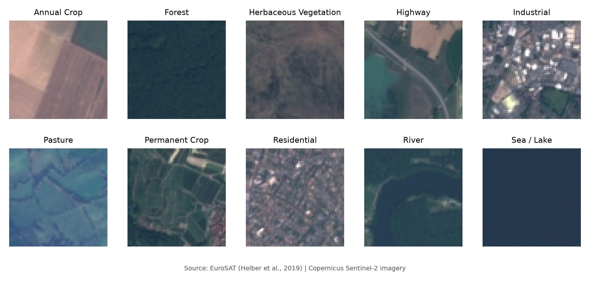

---
title: "Projects"
page-layout: full
---

A selection of projects in data analysis, machine learning and computational social science.

<h3>Satellite Image Classification</h3>

An interactive deep learning application for vegetation
classification using multispectral Sentinel-2 satellite
imagery and the EuroSAT dataset.

Explore different spectral representations and classify
satellite images in real time using a trained convolutional
neural network.

Python
TensorFlow
Keras
EuroSAT
CNN
NDVI
JavaScript

<a class="profile-button" href="satellite-classifier.html">
Explore project →
</a>

<h2>Further Projects</h2>

<i class="bi bi-folder2-open"></i>

Coming soon

